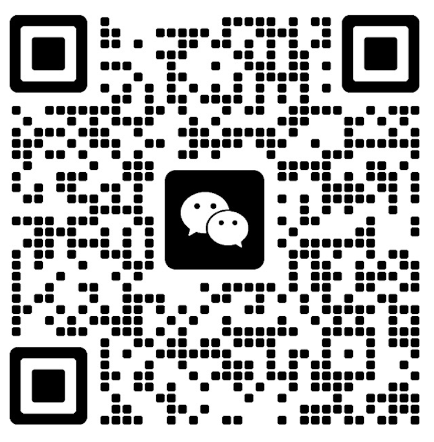

<p align="center">
  
</p>

冬离，高中物理老师，前蓝禾亚马逊广告负责，亚马逊卖家。现在主要专注 AI Agent 怎么赋能到亚马逊行业，当前阶段核心的赋能场景围绕运营、广告两个板块。自研 Agent 网站：[https://sshso.com/](https://sshso.com/)，覆盖：选品、广告两个大场景，注册就送3000积分。

同时也有自己的 Agent 社群，有需要可以扫码加我助理加群。目前社群人数相对少，欢迎大家的加入。

---

# Ads Hub（ShareScope 亚马逊广告报表看板）

当前版本：`0.1.0` · 许可证：MIT · 源码：https://github.com/DongLiyaaa/ads-hub

用于分析亚马逊商品推广报表的自托管工作台，将搜索词展示份额、广告位和已购买商品报表转换为可筛选、可下钻、可持续复盘的分析看板。

## 核心功能

- **三类广告报表看板**：搜索词展示份额、广告位和已购买商品分析，支持筛选、排序、分页及 CSV 导出。
- **AI 洞察与历史版本**：按数据集和时间范围保存分析结果，重新分析不会覆盖旧版本。
- **多租户与店铺授权**：区分租户管理员和普通用户，服务端强制校验店铺访问权限。
- **双 Agent 支持**：可切换 Codex CLI 或 Claude Code，支持连通性自检和 Codex OAuth。
- **可自托管**：使用 PostgreSQL 持久化，提供 Docker 部署；报表浏览器缓存两小时，不依赖 Redis。

## 数据准备

使用你自己的亚马逊商品推广报表，仓库不附带业务数据。准备数据并配置 PostgreSQL 后执行：

```bash
npm run db:import
```

文件命名、格式转换和导入规则见[数据导入指南](docs/data-import.md)。

## 报表入口

- `#/search-share`：搜索词展示份额分析。
- `#/placement`：商品推广广告位报表分析。
- `#/purchased-product`：商品推广已购买商品报表分析。
- `#/agent-settings`：Agent 与模型配置、启用切换和连通性自检。

三个页面共享左侧报表导航和顶部时间筛选；Hash 路由支持直接访问、刷新及浏览器前进/后退。宽表提供可见滚动条、左右滚动按钮、键盘焦点和溢出提示，右侧指标可完整查看。

## 搜索词展示份额

- KPI：加权平均展示份额、展示量、点击量、搜索词数。
- 展示份额折线图：整体趋势 / 全周期展示量 TOP 5 关键词对比。
- 搜索词词云：默认前 100 词，可切换 50 / 200 词；悬浮查看完整词语与展示量。
- 关键词汇总表：搜索、列排序、50 / 100 / 200 条分页、指定页跳转、导出当前筛选结果 CSV。
- AI 全量数据洞察：分析当前时间范围内的全部关键词、全部广告活动、每日整体趋势、TOP 5 关键词趋势和前 100 词词云。
- 确定性透视：销售额 TOP 10 核心关键词、最差 5 个广告活动、最差 50 个关键词；不调用模型也可查看。

### 搜索词汇总口径

同一日期、同一搜索词可能出现在多个广告活动中，其展示份额与排名相同。因此先按“日期 + 客户搜索词”合并：

- 展示份额、展示排名不重复累加。
- 展示量、点击量、订单、花费、销售额累加。
- 时间范围内的展示份额与排名按展示量加权；展示量为 0 时份额使用算术平均。
- CTR = 点击量 / 展示量；CVR = 订单 / 点击量；ACOS = 花费 / 销售额，分母为 0 时显示 `—`。
- 广告活动从原始 CSV 行独立透视，不从已合并的关键词反推。

低效评分只纳入当前时间范围内花费大于 0 的关键词或广告活动，总分 0–100，越高越低效：花费权重 50、CVR 权重 30、ACOS 权重 20。该分数用于筛选和复核，不建议据此直接批量调整广告。

## 广告位报表分析

标准数据粒度为“日期 + 广告组合 + 广告活动 + 广告位”，覆盖搜索首页顶部、搜索结果其余位置和商品页面三类广告位。

- KPI：总花费、7 天总销售额、7 天总订单数、综合 ACOS。
- 单指标每日趋势：ACOS、花费、销售额、订单、CTR、CVR、CPC、ROAS；缺失日期不补零。
- 100% 结构图：比较三类广告位的花费、销售额和订单占比。
- 广告位表现表与“竞价策略 × 广告位”矩阵。
- “广告活动 × 广告位”下钻：搜索、组合/策略/广告位筛选、列排序、展开/收起、50 / 100 / 200 条分页、指定页跳转和筛选后完整 CSV 导出。
- 确定性透视：广告位表现、最多 10 条扩量候选和最多 50 条止损候选。
- AI 分析：结构、每日趋势、活动下钻、策略组合和 7 / 14 / 30 天行动建议。

### 广告位指标口径

所有比率都从当前筛选范围汇总后的基础字段重新计算，不平均每日百分比，也不相加每日比率：

- CTR = 点击量 / 展示量。
- CPC = 花费 / 点击量。
- CVR = 7 天订单数 / 点击量。
- CPO = 花费 / 7 天订单数。
- ACOS = 花费 / 7 天销售额。
- ROAS = 7 天销售额 / 花费。
- 花费、销售额、订单占比 = 当前广告位值 / 当前范围三类广告位总值。

零分母显示 `—`，不伪造成 0。报告内曝光或订单结构不等于亚马逊市场份额。

### 候选规则与限制

仅纳入花费大于 0 且点击量不少于 30 的“广告活动 × 广告位”组合：

| 类型 | 规则 | 优势 | 局限与风险 |
|---|---|---|---|
| 风险复核 | 无订单，或 ACOS 高于整体 25%，或 CVR 低于整体 25%，或 CPC 高于整体 25% | 快速定位需要下钻的相对异常 | 不代表应直接暂停；止损可能损失订单 |
| 扩量候选 | ACOS 低于整体且 CVR 不低于整体，或 CPO 低于整体 20% | 发现相对高效的细分组合 | 不代表盈利；扩量后 CPC、ACOS 可能上升 |

源报告缺少毛利、目标 ACOS、预算、当前广告位溢价、关键词、匹配模式和 ASIN，因此看板不会虚构这些维度。所有候选与 AI 建议仅用于人工复核，不会自动调整广告。

## 已购买商品报表分析

页面将“广告投放 ASIN”和“已购买 ASIN”分开分析，避免把引流能力误当成购买商品自身的直接投放效率。

- KPI：7 天内其他 SKU 销售额、订单数、销售量、广告 ASIN → 购买 ASIN 路径数。
- 每日趋势：整体与销售额 Top 3 购买 ASIN 的销售额、订单或销售量；缺失日期不补零。
- Top 5 承接商品：按购买 ASIN 的其他 SKU 销售额和销售占比排序。
- 明细视图：已购买 ASIN、广告投放 ASIN、购买路径；支持搜索、列排序、分页、跳页和当前筛选结果 CSV 导出。
- 确定性透视：承接商品 Top 10、引流商品 Top 10 和销售额最高的 20 条路径。
- AI 分析：承接结构、购买 ASIN、广告 ASIN、关键路径与 7 / 14 / 30 天复核建议。

### 已购买商品指标口径与限制

| 维度 | 汇总方式 | 可以回答 | 不能直接回答 |
|---|---|---|---|
| 已购买 ASIN | 按 Purchased ASIN 汇总其他 SKU 销售额、订单、销售量及来源广告 ASIN | 哪些商品承接了广告带来的购买 | 该商品自身投放是否盈利、是否应直接扩量 |
| 广告投放 ASIN | 按 Advertised ASIN 汇总其带动的购买结果 | 哪些广告商品是多路径引流入口 | 引流入口的 ACOS、CVR 或直接止损价值 |
| 购买路径 | 按 Advertised ASIN + Purchased ASIN 汇总 | 哪些商品组合产生较高归因销售 | 是否同父体、是否应直接迁移预算 |

- 销售额、订单和销售量均保留源报告的“7 天内其他 SKU”口径；不能将其解释为账户完整 Same-ASIN / Cross-ASIN 报告。
- 购买 ASIN 销售占比 = 该购买 ASIN 其他 SKU 销售额 / 当前范围其他 SKU 销售额；路径占比同理。
- “承接中心候选”“被动承接候选”“引流入口候选”等均为确定性候选标签，不是投放或盈利结论。
- 缺少 Spend、Clicks、Impressions、Purchased SKU、父子 ASIN 映射、利润、库存和购买 ASIN 直接投放效率，因此不计算 ACOS、CPO、CVR、CTR，不判断同父体，也不自动迁移预算。

## 本地开发

```bash
npm ci
npm run dev:api
```

另开终端：

```bash
npm run dev
```

打开 `http://127.0.0.1:5173/#/placement`。Vite 将 `/api` 代理到 `127.0.0.1:8787`。

现有验证命令：

```bash
npm test
npm run build
```

## Agent、协议与自检

在 `#/agent-settings` 选择并保存当前分析 Agent：

| Agent | 模型协议 | 优势 | 限制 |
|---|---|---|---|
| Codex CLI | OpenAI Responses API | 可连接 OpenAI 或支持 Responses 的兼容网关 | 当前锁定的 Codex 0.163.0 已移除 Chat Completions，不支持仅提供 Chat 的服务 |
| Claude Code | Anthropic Messages API | 使用 Claude Code 原生 Anthropic 协议，默认模型为 `claude-opus-5-5` | OpenAI 服务需先经 Anthropic 协议转换网关 |

Codex CLI 支持两种认证方式：

| 认证方式 | 优势 | 限制 |
|---|---|---|
| API Key | 可连接 OpenAI 或自定义 Responses 网关，密钥加密保存 | 需要自行管理密钥，不使用 ChatGPT 账号订阅 |
| ChatGPT OAuth | 无需填写 API Key，通过设备码完成官方账号授权 | 需要本人在浏览器确认；设备码 15 分钟过期，不使用自定义 Base URL |

选择“ChatGPT OAuth”后点击“开始 OAuth 登录”，打开页面显示的 OpenAI 验证地址并输入一次性设备码。授权完成后页面自动更新登录状态，再点击“保存并启用”即可自检或用于报表分析。开始新登录会替换应用内现有 Codex CLI 凭据，其他同账号 CLI 会话可能需要重新登录，但不会删除数据库中保存的 API Key。访问令牌只由 Codex CLI 写入 Codex Home，不返回浏览器。

- Base URL、模型、接口模式、Codex 认证方式和超时时间保存到 PostgreSQL；每次保存递增配置版本，并清除旧自检状态，避免误用旧结果。
- API Key 使用 `MODEL_CONFIG_ENCRYPTION_KEY` 进行 AES-256-GCM 加密，只写入、不回显；接口仅返回末四位提示。留空保留旧密钥，也可主动清除。加密密钥丢失后，已保存 API Key 无法恢复。OAuth 启用时保留但不使用已保存密钥，也不会把密钥传给 Codex 子进程。
- Codex OAuth 使用 CLI 原生 `login --device-auth`，认证状态与登录进度分离；未登录时自检不会发送模型请求。OAuth 使用 OpenAI 官方 provider 和文件凭据存储，自定义 Base URL 不生效。
- 自检依次检查 CLI 运行时、认证配置和一次最小模型请求；只有点击“检查 Agent 连通性”才调用模型，可能消耗少量额度。最近自检状态、时间和耗时持久化，刷新后保留。
- 自定义 Codex provider 使用隔离的临时 `CODEX_HOME`，避免加载本机无关插件、MCP 或 ChatGPT 登录；API Key 通过环境变量传给子进程，不进入命令行参数。
- Claude Code 使用非交互输出、空工具集、空 MCP、无会话持久化和隔离设置来源。容器未挂载整个 `~/.claude`；容器内使用自定义 Anthropic 服务时应配置 API Key。

## 数据与 AI 历史持久化

- PostgreSQL 保存三类报表标准行、数据集和 AI 分析版本。启动时自动执行 `db/migrations`，数据库连接池最多 5 个连接。
- AI 历史以“报表类型 + 数据集 + 起止日期”为唯一范围；每次重新分析递增版本，旧版本永久保留，页面恢复该范围最新一条。
- 历史记录包含输入快照、请求哈希、模型、Agent 类型、配置版本、生成时间和当前版本标记。
- 只有点击“开始 AI 分析”才发送当前筛选后的完整汇总数据，不上传原始 CSV 或 XLSX 文件。报表正文不会写入服务端错误日志。
- 最多同时处理 2 个分析请求；服务端和前端等待上限随当前配置调整，最长 600 秒（前端额外等待 10 秒）。
- 时间范围或报表变化会取消前端等待并清空旧报告，避免旧结果覆盖新范围。

## Docker（linux/amd64）

镜像固定 `linux/amd64`，容器名为 `search-share-dashboard`，端口仅绑定 `127.0.0.1:18090`，不依赖或修改其他容器。

```bash
docker compose build
docker compose up -d
```

访问 `http://127.0.0.1:18090/#/placement`。生产镜像基于 Node.js 22，托管静态文件和 API，包含 `@openai/codex` 0.163.0 与 `@anthropic-ai/claude-code` 2.1.323。

Compose 将宿主机 `~/.codex/auth.json` 与 `config.toml` 只读挂载到 `/mnt/codex`，启动脚本只在独立 `sharescope-codex-home` 卷首次初始化时导入凭据，避免重启覆盖应用内新完成的 OAuth 登录。后续 OAuth 凭据保存在该命名卷中，容器替换后仍可恢复；Claude Code 不挂载宿主机凭据目录，请在设置页保存 API Key。AI 是否可用取决于运行时、凭据和模型服务；确定性表格和透视不依赖模型。

`.env` 必须设置 `PGPASSWORD` 和 64 位十六进制 `MODEL_CONFIG_ENCRYPTION_KEY`。请勿提交真实密码、API Key 或加密密钥。

查看状态与日志：

```bash
docker compose ps
docker compose logs --tail=100 dashboard
```

停止看板（会移除本项目的 Compose 容器，不影响无关服务）：

```bash
docker compose down
```